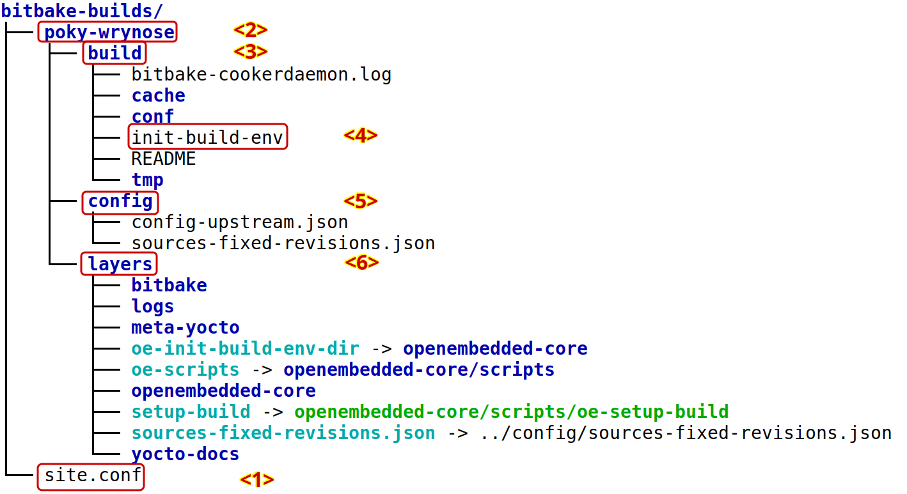

= Getting Started with Yocto
Zilogic Systems <training@zilogic.com>
:data-uri:

== Working with Yocto

=== Setting up Yocto

 * Install dependencies for Yocto build

[source,shell]
----
$ sudo apt-get install build-essential chrpath cpio debianutils diffstat file gawk \
gcc git iputils-ping libacl1 libcrypt-dev locales python3 python3-git \
python3-jinja2 python3-pexpect python3-pip python3-subunit python3.13-venv socat texinfo unzip \
wget xz-utils zstd
----

 * Install the `bitbake-setup` command-line tool in a Python virtual environment

[source,shell]
----
$ python3 -m venv --clear ~/bitbake-setup-venv
$ . ~/bitbake-setup-venv/bin/activate
$ pip install bitbake-setup
----

=== Setting Up Yocto (1)

 * To start using `bitbake-setup`, run:

[source,shell]
------
$ bitbake-setup init
------

 * Select `poky-wrynose` as the Configuration Template.
 * Select `poky` as the bitbake configuration.
 * Select `machine/qemuarm64` as the Target machine.
 * Select `distro/poky` as the Target distribution.

=== Setting Up Yocto (2)

==== Left

==== Right

  . Shared configuration applied across all setups in this workspace
  . BitBake Setup directory named after your configuration choices
  . BitBake build directory with configuration files and build artifacts
  . Script for setting-up the build environment
  . Version-controlled copy of the specific configuration used
  . Cloned layer repositories

=== Setting Up Yocto (3)

 * Set up the yocto build environment by sourcing _init-build-env_ script file.

[source,shell]
------
$ source ~/bitbake-builds/poky-wrynose/build/init-build-env
------

 * The script initializes the BitBake build environment and switches to the
   build directory.

 * For our experiment we are going to use an arm target board emulated through
   QEMU, which we have selected as the Target Machine type during `bitbake-setup
   init`.

=== Need for Configuration File

 * There are configurations other than MACHINE & DISTRO, which may need to be
   passed to the poky build environment.

 * Passing all required configurations through environment variables
   would be inconvenient.

 * And also the Poky accepts only limited configurations through
   environment variables.

 * To manage this, Poky provides a mechanism of passing configurations
   through file.

=== Managing Configurations in File 

 * One such high level user manageable configuration file is
   local.conf

[source,shell]
------
$ vim build/conf/local.conf
------

 * Other parameters like number of threads to use, location for
   downloading the sources, etc., can be given through local.conf

=== Reducing Build Time

 * Since yocto build would take huge build space, build time and
   download bandwidth, it has facility to cache and reuse the build
   state and download directories

 * We can reuse the download dir and state-cache made available by us
   in ${HOME} by adding below information to the
   build/conf/local.conf

------
DL_DIR = "${HOME}/downloads"
SSTATE_DIR = "${HOME}/sstate-cache"
------

=== Top-level Build Configuration

 * Recent Yocto releases introduced a concept called `Configuration fragments`
   which is used to do a high level configuration of the build using the
   `bitbake-config-build` tool.

 * Configuration Fragments define top level build configuration features that
   can be independently enabled and disabled using standard tooling.

[source,shell]
------
$ bitbake-config-build list-fragments
$ bitbake-config-build enable-fragment <feature>
$ bitbake-config-build disable-fragment <feature>
------

=== Enable Root login with empty password

 * By default, user/root login is not supported in Yocto builds.

 * This can be enabled by enabling the following configuration fragment:

[source,shell]
------
$ bitbake-config-build enable-fragment core/yocto/root-login-with-empty-password
------

=== Building Minimal Rootfs

 * To build the rootfs image, image name to be built has to be given
   as argument to bitbake.

 * core-image-minimal is a minimal console-only rootfs supported by
   poky and which can be built as shown below.

[source,shell]
------
$ bitbake core-image-minimal
------

 * Built kernel and rootfs images would be available in
   `build/tmp/deploy/images/${MACHINE}` directory.

 * Along with the images you may also find manifest files describing
   the packages available in rootfs.

=== Build Artifacts

 * The build should get completed in fewer minutes as it tries to
   reuse state-cache

 * After successful completion of the build the kernel image and
   rootfs images would be available in the tmp/deploy/images/qemuarm64

[source,shell]
--------------
$ ls tmp/deploy/images/qemuarm64/
--------------

 * The list of packages in rootfs can be read from manifest file.

[source,shell]
--------------
$ cat tmp/deploy/images/qemuarm64/core-image-minimal-qemuarm64.rootfs.manifest
--------------

=== Booting Image with QEMU

 * The generated qemuarm64 image can be booted using runqemu.

[source,shell]
------
$ runqemu snapshot nographic
------

=== Customizing the Build

* It is possible to customize the Poky build, to add a package to
  image or to exclude a package from the build through configuration.

* We can add a package to image by appending package name to he
  IMAGE_INSTALL variable.

* We can exclude a package from the build by appending the package
  name to PACKAGE_EXCLUDE variable.

=== Knowing Packages and Their Dependencies

* let's check the packages built in core-image-minimal by using -g
  option

[source,shell]
------
$ bitbake -g core-image-minimal
------

* Which generates a file named _pn-buildlist_ which has list of
  packages that would be built by core-image-minimal.

[source,shell]
------
$ vim pn-buildlist
------

* From this list we can find that, what is not built by
  core-image-minimal recipe.

=== Adding Package to a Build

* We can find the package name and version of the using
  --show-version option of bitbake as

[source,shell]
------
$ bitbake -s | grep <package>
------

* We can enable building a package by adding below line to local.conf

------
IMAGE_INSTALL += <package>
------

=== Need for Layer

 * Any changes made in build/conf/local.conf is temporary and it cannot me
   maintained, shared or version controlled.

 * `local.conf` is suitable for local experiments and build-specific settings.

 * Better practise is to maintain all our permanent changes in separate layer,
   which can be maintained in version control system.

=== References

 . https://docs.yoctoproject.org/ref-manual/system-requirements.html
 . https://docs.yoctoproject.org/bitbake/2.18/bitbake-user-manual/bitbake-user-manual-environment-setup.html
 . Embedded Linux Development Using Yocto Project - Fourth Edition : Otavio
   Salvador, Daiane Angolini
