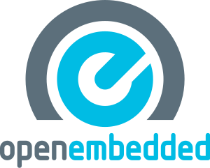
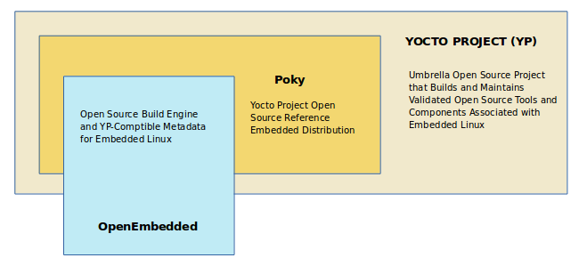
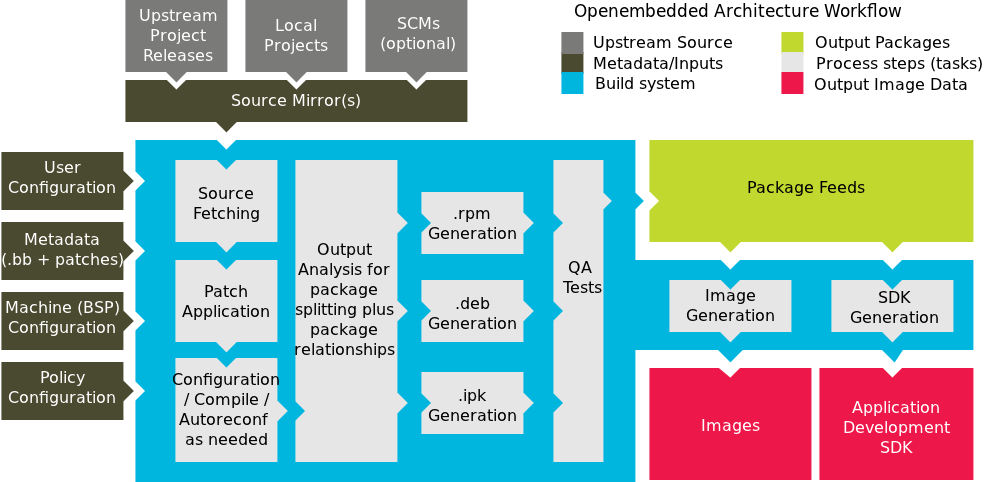
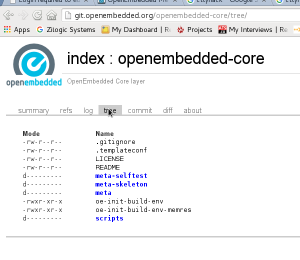
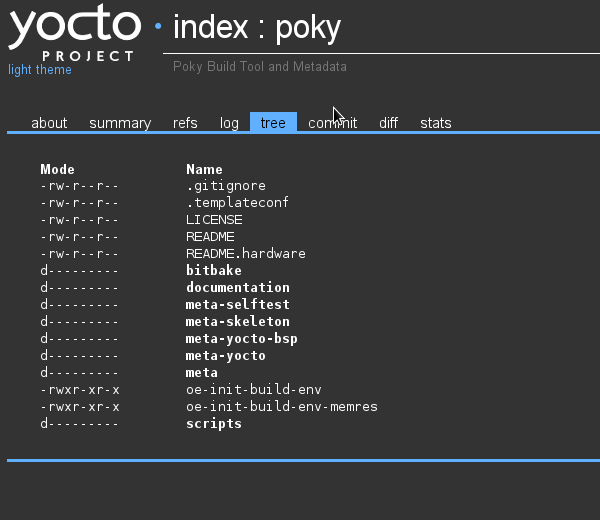
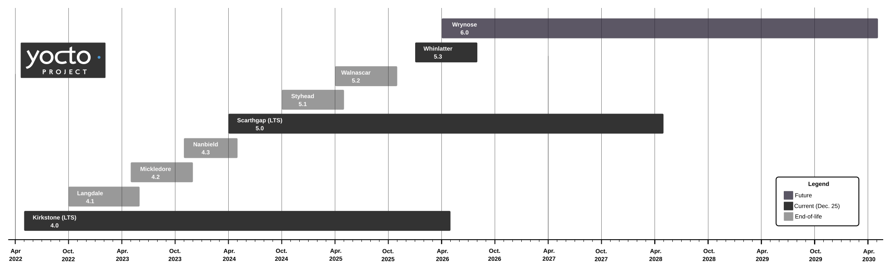
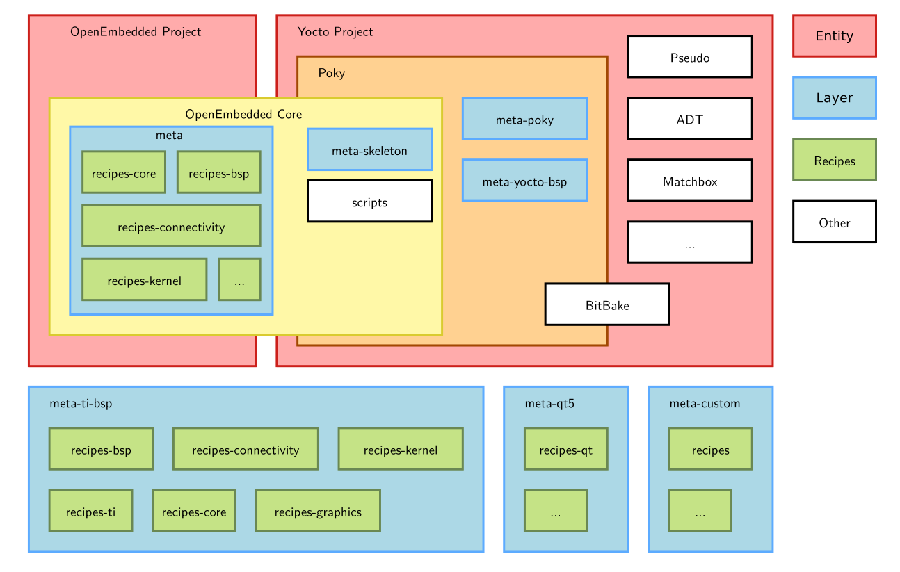
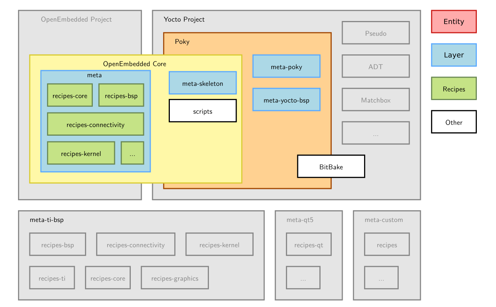

= Yocto - Introduction
Zilogic Systems <training@zilogic.com>
:data-uri:

== Preface

=== Limitations of Zepto

 * The project Zepto which has been developed previously, builds only
   3 software components and has recipes, to create a rootfs image
   with it.

 * For a bigger embedded Linux projects, these 3 components would not
   be sufficient and it may require us to write recipes for huge list
   of packages.

=== Solution

==== Right

 * To address these issues developers of bitbake had developed recipes
   for many open-source projects and supportive infrastructure to
   create different file-system images.

 * Bitbake developers grouped these recipes in meta layers and this
   complete build infrastructure is called as OpenEmbedded build
   system.

==== Left

=== History of Yocto Project

 * OpenEmbedded started around 2003 as a build system for
   embedded Linux distributions.

 * BitBake was separated from OpenEmbedded as an independent
   task execution engine around 2004.

 * The Yocto Project was launched by the Linux Foundation in 2011.

 * Yocto Project and OpenEmbedded work closely together:

 ** OpenEmbedded maintains BitBake and OpenEmbedded Core (OE-Core).

 ** Yocto Project provides reference distribution metadata,
    documentation, QA infrastructure and project governance.

 * Poky is the Yocto Project reference distribution.

== Introduction to Yocto

=== What is Yocto

==== Right

 * Is an Umbrella project, involves developing build tools to
   facilitate building of custom distribution for the embedded devices.

 * More than a build system, it focuses on complete build cycle
   involving compiling, debugging, testing on simulated hardware.

==== Left

=== Yocto's Unique Features

 * Supports segregating and maintaining build recipes in atomic layers
   for different providers separately.

 * Required layers can be pulled into build system, when required.

 * Supports sufficient infrastructure to perform post build analysis
   on the build artifacts, for their size, dependency, quality and
   licenses.

 * Application developer-centric tools and workflow.

 * Reproducible builds and efficient build acceleration using State Caches.
 
=== Yocto Over Pre-built Distros

  * Allows building a custom rootfs from source for small footprint
    devices.

  * Building with desired tool-chain.
  
  * Allows building software components for processor specific
    support. Ex: Compiling X11 with Processor specific graphic
    accelerators.

  * Supports handling open source and proprietary licensed software
    build.

=== Yocto Over Buildroot

==== Right

  * Supports list of well tested open source software.

  * Allows building a managed rootfs with deb/rpm/ipk packages.

  * Provides a complete embedded development environment.

  * Well organized as layers and easily extendable

  * Allows testing software on emulators without a real target device.

==== Left

=== Yocto internal projects

Yocto develops several projects to improve build infrastructure

 * Poky - reference build system

 * Autobuilder - build and test automation tool

 * eSDK - Extensible SDK for developing applications and images

 * Pseudo - Provides a fake root environment required to improve build

 * Toaster - UI tools to manage Yocto build and their results

 * Documentation - Detailed manuals to use Yocto for various embedded
   build scenarios.

 * Yocto project components are maintained in git repo
   https://git.yoctoproject.org/

=== Poky

==== Right

 * Poky is an independent open source project, Yocto uses Poky as its
   reference system.

 * Yocto tests and provides the Poky build environment as part of its
   releases, which when built, provides Poky reference distribution by
   default.

 * Over OpenEmbedded build system, Poky builds SDK and debugger as IDE
   plugins, integrates QEMU for target simulation.

==== Left

=== OpenEmbedded

 * OpenEmbedded is an independent project for embedded Linux build
   system.

 * OpenEmbedded Classic is a massive project which has thousands of
   recipes and hundreds of target boards.

 * Which has become a much bloated and hard to maintain.

 * Yocto and OpenEmbedded share bitbake and a specific metadata(set of
   recipes) called OpenEmbedded-core.

 * Over OpenEmbedded community, Yocto ensures that oe-core meta-data
   are well-tested and inter-operable with platforms supported by
   Yocto.

 * OpenEmbedded maintains bitbake and other recipes in
   http://cgit.openembedded.org/

 * New changes in bitbake and openembedded-core layers are merged
   first into OpenEmbedded repository and later pulled by Poky repo.

=== OE Vs Poky Repo

==== Right

==== Left

=== Yocto Releases

 * Two releases are normally made each year.

 * One release every two years becomes an LTS release.

|====
| *Codename* | *Version* | *Status*
| Wrynose    | 6.0 | LTS - until Apr 2030
| Whinlatter | 5.3 | EOL
| Walnascar  | 5.2 | EOL
| Styhead    | 5.1 | EOL
| Scarthgap  | 5.0 | LTS - until Apr 2028
|====

=== Release Timeline

   * From Yocto 5.3 onward, the traditional combined Poky repository workflow
     changed to a new multi-repository setup, managed using a new tool called
     `bitbake-setup`.

=== Yocto Project Structure

=== Poky layers

== Yocto Architecture

=== Yocto WorkFlow

  * `Inputs:` source code and build configuration.

  * `Build process:` Yocto fetches, builds, packages, and checks the software.

  * `Outputs:` deployable Linux images, package feeds, and SDKs.

=== User Configurations

 * User can configure the build parameters through configuration
   files.

 * Name of the target board for which the software is built.

 * Build time optimization parameters.
 
 * Path of the different layers and their recipes.

 * Build features like build statistics.

=== Metadata

 * Meta Layer - has configurations, classes and build recipes for
   software packages specific to a layer.

 * Distro Layer  - has configurations and recipes which affects the build
   policy.
 
 * Machine Layer - has configurations and recipes related to target
   board and processor.

 * Image - Recipe that contains the list of packages to be installed into the
   rootfs and type of the rootfs to be built.

=== Build Process

Build process involves

* Scanning through recipes and their dependencies.

* Building the data store of the variables.

* Generating tasks list and scheduling them.

* Executing independent tasks parallely in separate processes.

* Archiving logs, manifests, packages and images in respective
  folders.

* Caches parsed recipes and build artifacts states, for later reuse.

=== Fetch and Build Tasks

* Uses the fetcher component to download, verify and unpack sources
  from

 ** Releases - tar/zip 

 ** SCMs - SVN, Git, CVS etc
  
 ** Local Projects - local folders

* Later the available patches are applied over the unpacked source.

* Then it configures, builds and installs the software packages.

* Build outputs are analyzed and split into normal, dev, dbg & doc
  packages and creates metadata for the packages.

=== Quality Assurance Checks

  * Can run various quality assurance processes through INSANE class.

  * Checks the build outputs for
    ** build time and run-time dependencies
    ** arch specific verification of ELF type, endianness and bit size.
    ** incompatible licenses

=== Package Feed and Images Tasks

* Then the deb/rpm/ipk packages are built and placed into package feed
  area.

* The verified packages are available in separate architecture specific
  folders.

* The target specific packages available in package feed, can be
  installed into the rootfs.

* Type of rootfs can be controlled through image specific variables.

* The image specific manifest files are created for further analysis.

* The package feeds can also be exposed as a repo through web server,
  so the packages in the target system can be updated at run-time.

=== References

 . https://docs.yoctoproject.org/wrynose/
 . https://docs.yoctoproject.org/wrynose/overview-manual/
 . https://docs.yoctoproject.org/wrynose/ref-manual/
 . https://docs.yoctoproject.org/bitbake/
 . Embedded Linux Development Using Yocto Project - Fourth Edition : Otavio
   Salvador, Daiane Angolini

== Credits

=== Photo Credits

 . https://bootlin.com/doc/training/yocto/yocto-slides.pdf (pg 35)
 . https://bootlin.com/doc/training/yocto/yocto-slides.pdf (pg 40)
